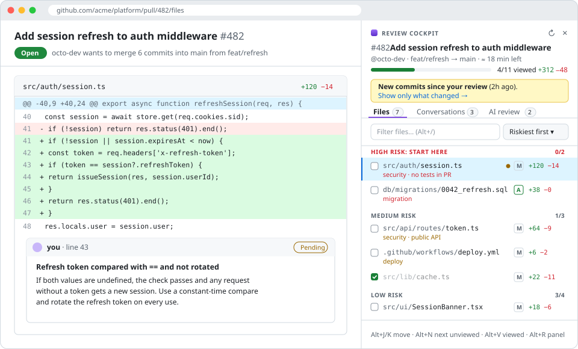

<p align="center">
  
</p>

<h1 align="center">Review Cockpit for GitHub</h1>

<p align="center">
  <strong>Review pull requests faster when AI writes most of the code.</strong><br />
  A browser extension that shows you what to read first, what changed since you last looked,<br />
  and what Claude thinks is broken, right inside GitHub.
</p>

<p align="center">
  <a href="LICENSE"></a>
  
  
  
  <a href="#contributing"></a>
</p>

<p align="center">
  <a href="#install">Install</a> ·
  <a href="#features">Features</a> ·
  <a href="#keyboard-shortcuts">Shortcuts</a> ·
  <a href="#privacy-and-security">Privacy</a> ·
  <a href="#faq">FAQ</a> ·
  <a href="#contributing">Contributing</a>
</p>

<p align="center">
  
</p>

---

## Why

Code review didn't scale with AI-written code. Pull requests got bigger and more frequent, while the review screen stayed the same:

- **Where do I start?** A 40-file PR lists `package-lock.json` right next to the auth change that actually matters.
- **What's new?** The author pushed again. Which files changed since *your* review, and were your comments addressed?
- **What's waiting on me?** Review requests are spread across notifications, email and Slack.
- **Can AI take a first pass?** Only by copying the diff into a chat window by hand.

Review Cockpit adds a panel to every pull request and a review queue to your toolbar. It answers each of those questions in one place.

## Features

### 🎯 Start with the riskiest files

Files are ranked **High → Medium → Low risk**, and each one shows why: `security`, `migration`, `payments`, `public API`, `deploy`, `large change`, `no tests in PR`. Read the dangerous code while you're fresh. Lockfiles, `dist/`, snapshots and generated code are hidden by default. ([How risk is scored](#how-risk-is-scored).)

### 🔁 See what changed since you last looked

- When the author pushes after your review, a banner links to **only the new commits** since then.
- Files that changed after you marked them viewed get a dot.
- The **Conversations** tab lists every unresolved review thread and tags it **code changed** when the code under a comment has been modified since. That's usually the sign your feedback was addressed.

### 🤖 AI review, with you in charge

Click **Run AI review** and Claude reads the diff, then lists likely bugs, security problems and missing tests, each with a severity and an exact file and line.

- Click a finding to jump to that line in the diff.
- Click **Add as draft comment** to put it in your *pending* GitHub review. Nothing is visible to anyone until you click **Finish your review** on GitHub.
- It uses **your own Anthropic API key** with Claude Opus 5.5 (or Sonnet 5.5 for speed). There's no server in between.

Prefer your own tools? **Copy for AI** copies the PR description and the cleaned-up diff, with a review prompt, ready to paste into Claude, ChatGPT, Cursor or any agent.

### ⌨️ Keyboard-first

Move through files, mark them viewed, and jump to the next unviewed one without touching the mouse. *Viewed* uses GitHub's real "Viewed" state, so it stays in sync across devices and with GitHub's own UI.

### 📥 Your review queue, across every repo

The toolbar popup shows:

- **Needs your review**, with a size label on each PR (XS to XL)
- **Updated since you reviewed**: one click opens only the new changes
- **Your open PRs**, with approved / changes requested status

The icon shows a badge count, refreshed every 5 minutes.

### And the small things

- **≈ N min left**: a reading-time estimate for the files you haven't viewed yet
- **Private notes** for each PR, saved in your browser
- **Matches your GitHub theme**, including light, dark and high contrast
- **Makes room for itself** on wide screens instead of covering the diff

## Install

There's no web store release yet. You can install it from source in about a minute:

1. **Get the code.** Either `git clone https://github.com/Sajal1005/review-cockpit.git` or click **Code → Download ZIP** and unzip it.
2. **Load it.** Open `chrome://extensions` (or `edge://extensions`), turn on **Developer mode**, click **Load unpacked**, and select the folder.
3. **Connect GitHub.** The settings page opens automatically. Create a token, paste it in, and click **Save & verify**:
   - **Quickest:** [classic token with the `repo` scope](https://github.com/settings/tokens/new?scopes=repo&description=Review%20Cockpit)
   - **Least privilege:** [fine-grained token](https://github.com/settings/personal-access-tokens/new) with *Pull requests: Read and write* and *Contents: Read*
   - If your organization uses SAML SSO, click **Configure SSO → Authorize** next to the token.
4. **Optional: turn on AI review.** Paste an [Anthropic API key](https://console.anthropic.com/settings/keys) on the same page.
5. **Open any pull request** on github.com. The panel appears on the right.

> **Tip:** Pin the extension (puzzle-piece icon → pin) so your review queue is one click away.

To update later, `git pull` (or download the ZIP again), then click ↻ on the extension in `chrome://extensions`.

## Keyboard shortcuts

| Keys | Action |
|---|---|
| <kbd>Alt</kbd> + <kbd>J</kbd> / <kbd>K</kbd> | Next / previous file |
| <kbd>Alt</kbd> + <kbd>N</kbd> | Next unviewed file |
| <kbd>Alt</kbd> + <kbd>V</kbd> | Toggle *Viewed* and jump to the next unviewed file |
| <kbd>Alt</kbd> + <kbd>/</kbd> | Filter files |
| <kbd>Alt</kbd> + <kbd>R</kbd> | Show / hide the panel |

On macOS, <kbd>Alt</kbd> is <kbd>⌥ Option</kbd>. Shortcuts are ignored while you're typing in a GitHub comment box.

## How risk is scored

Every file starts with a base score, and signals add to it. The score is deliberately simple and transparent, so you can predict it and argue with it.

| Signal | Score |
|---|---|
| Base: source file / config / test / docs, generated or lockfile | 2 / 1 / 0.5 / 0 |
| Path suggests **security**, **migration** or **payments** (e.g. `auth`, `session`, `migrations/`, `.sql`, `billing`) | +3 |
| Path suggests **public API** or **deploy** (e.g. `routes/`, `.proto`, `.github/workflows/`, `terraform/`) | +2 |
| 300+ changed lines (*large change*) / 100+ changed lines | +2 / +1 |
| Source file with 20+ added lines and no matching test file in the PR | +1 |
| File deleted | −1 |

A score of **5 or more is high risk**, and **3 or more is medium**. Path signals only apply to source and config files, so `docs/auth.md` isn't flagged as security. The rules live in [`src/shared/core.js`](src/shared/core.js) and are unit-tested. Ideas for better signals are very welcome.

## AI review: what to expect

- **What gets sent:** the PR title, description and diff, with generated files and lockfiles removed. It's sent only when you click **Run AI review**, directly from your browser to `api.anthropic.com` with your key.
- **Accuracy:** each line of the diff is labelled with its line number before it's sent, so findings point at lines GitHub can attach a comment to. Claude is asked for few, high-confidence findings and to skip style nits.
- **Time:** usually 1–3 minutes for a typical PR.
- **Cost:** billed to your Anthropic account at [standard API rates](https://www.anthropic.com/pricing). A typical PR costs a few cents to a few tens of cents on Opus 5.5, and roughly half that on Sonnet 5.5.
- **Results are saved** for each PR in your browser. If new commits arrive, the tab tells you the review is out of date.

## Privacy and security

- **No servers, no analytics, no tracking.** The extension talks only to `api.github.com`, and to `api.anthropic.com` when you run AI review.
- Your **GitHub token and Anthropic key** are stored in `chrome.storage.local` on your machine, and are used only by the extension's background worker.
- **Nothing is posted on your behalf.** *Viewed* toggles use GitHub's own API, and AI findings become *pending* comments only when you click, visible to others only after you submit your review.
- All PR content (titles, paths, comments, AI output) is rendered as plain text, never as HTML.
- Permissions requested: `storage` and `alarms`, page access to `github.com`, and API access to `api.github.com` and `api.anthropic.com`.

Found a security issue? Please report it privately through the repo's **Security → Report a vulnerability** tab instead of opening a public issue.

## FAQ

<details>
<summary><strong>Does my team need to install it too?</strong></summary>

No. It only changes *your* view of GitHub. Viewed state and draft comments are ordinary GitHub features, so teammates see normal review comments.
</details>

<details>
<summary><strong>Why does it need a GitHub token?</strong></summary>

It reads PR data and GitHub's "Viewed" state through the GitHub API instead of scraping the page. GitHub changes its page structure often, and the API is what keeps the extension from breaking. The token never leaves your browser except in requests to `api.github.com`.
</details>

<details>
<summary><strong>Is AI review required?</strong></summary>

No. Everything except the *AI review* tab works without an Anthropic key, and nothing is ever sent to an AI provider unless you click **Run AI review**.
</details>

<details>
<summary><strong>Does it work with GitHub Enterprise or Firefox?</strong></summary>

Not yet. It currently supports github.com in Chromium browsers (Chrome, Edge, Brave, Arc). Both are on the [roadmap](#roadmap), and contributions are welcome.
</details>

<details>
<summary><strong>I ticked "Viewed" in the panel but GitHub's checkbox didn't change.</strong></summary>

The state is saved on GitHub immediately, but GitHub's page doesn't know it changed. Reload and you'll see it. Live sync is on the roadmap. The same applies to draft comments added from the AI tab.
</details>

<details>
<summary><strong>Something isn't working.</strong></summary>

For panel problems, open DevTools on the GitHub page (<kbd>F12</kbd> → Console). For API or popup problems, go to `chrome://extensions` and click **service worker** under Review Cockpit. Then [open an issue](https://github.com/Sajal1005/review-cockpit/issues) with the error and the browser you're using.
</details>

## Roadmap

- [x] Risk ranking with a "start here" list
- [x] AI review with findings added as pending review comments
- [x] Unresolved conversations with "code changed" detection
- [x] Review queue with "updated since you reviewed"
- [ ] Live sync of GitHub's on-page *Viewed* checkboxes and pending comments
- [ ] AI re-review: check whether each of your earlier comments was actually addressed by the new commits
- [ ] "Explain this hunk" on any diff selection
- [ ] Per-repo rules for noise and risk (e.g. `.github/review-cockpit.yml`)
- [ ] GitHub Enterprise Server support
- [ ] Firefox port
- [ ] Chrome Web Store and Edge Add-ons release

Have an idea? [Open an issue](https://github.com/Sajal1005/review-cockpit/issues). Stories about how you review PRs today are especially useful.

## How it works

```
manifest.json
src/
  background.js        Service worker: every GitHub and Anthropic API call, review queue, badge
  content/panel.js     The in-page panel (shadow DOM), keyboard shortcuts, SPA navigation handling
  content/panel.css    Panel styles, built on GitHub's own Primer CSS variables
  content/page.css     Makes room for the panel on wide screens
  popup/               Toolbar review queue
  options/             Token, API key and preferences
  shared/core.js       Pure logic: file classification, risk scoring, diff parsing, prompts (unit-tested)
  shared/ext.js        Browser helpers: tiny DOM builder, messaging, relative time
tests/                 node:test unit tests for shared/core.js
scripts/make_icons.py  Regenerates the icons (Python standard library only)
```

Design decisions:

- **The API over the page's HTML.** File lists, viewed state, review threads and history come from GitHub's GraphQL API. The only thing that touches GitHub's page is scrolling to a file, using the `#diff-<sha256(path)>` anchors GitHub itself uses.
- **No build step, no dependencies.** Plain JavaScript that the browser loads directly. Clone, load and edit, with nothing to install.
- **Shadow DOM, mounted on `<html>`.** GitHub's CSS can't leak in, and GitHub's page navigations, which replace `<body>`, don't remove the panel.
- **Secrets stay in the background worker.** API calls happen in the service worker, and the panel gets results through messages.

## Contributing

Contributions of all sizes are welcome: bug reports, risk signals, UI polish, new features.

```bash
git clone https://github.com/Sajal1005/review-cockpit.git
cd review-cockpit
npm test            # unit tests (Node 20+, nothing to install)
```

1. Load the folder as an unpacked extension (see [Install](#install)).
2. Make your change. After editing, click ↻ on the extension and refresh the GitHub tab.
3. Add or update tests for anything in `src/shared/core.js`.
4. Try it on a real PR. Big PRs (100+ files) and dark mode are good stress tests.
5. Open a pull request with a screenshot or short GIF of any UI change.

Please keep it dependency-free, and keep all network calls in `src/background.js`.

## License

[MIT](LICENSE). Free for personal and commercial use.

---

<p align="center">
  If Review Cockpit saves you time, please ⭐ the repo. It helps other developers find it.
</p>
